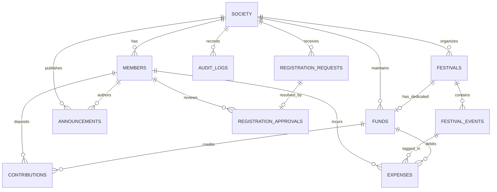

# Database Architecture & Schema Reference
## Bajrang Residential Society Fund Management System

### 1. Database Philosophy
- **Single Society Deployment**: Dedicated database instance for one residential society.
- **Exact Decimal Precision**: All currency values use `NUMERIC(12,2)`. No floating-point data types (`FLOAT`, `REAL`, `DOUBLE PRECISION`) are permitted.
- **Immutable Financial Ledger**: Posted transactions cannot be deleted. Any adjustments or cancellations are achieved via linked reversal or adjustment records.
- **Automated Activity Logging**: Every write operation triggers an immutable record in `public.audit_logs`.

---

### 2. Entity-Relationship Model


---

### 3. Core Tables Specification

#### 3.1 `public.society`
Stores the single society's legal entity and contact details.
- `society_id` (UUID, Primary Key, Default: `uuid_generate_v4()`)
- `society_name` (VARCHAR(150), NOT NULL)
- `address` (TEXT, NOT NULL)
- `city` (VARCHAR(100), NOT NULL)
- `state` (VARCHAR(100), NOT NULL)
- `pincode` (VARCHAR(10), NOT NULL)
- `contact_number` (VARCHAR(20), NOT NULL)
- `email` (VARCHAR(120))
- `created_at` (TIMESTAMPTZ, NOT NULL)
- `updated_at` (TIMESTAMPTZ, NOT NULL)

#### 3.2 `public.members`
Approved society residents with active voting and accounting access.
- `member_id` (UUID, Primary Key)
- `society_id` (UUID, FK -> `society.society_id`)
- `auth_uid` (UUID, UNIQUE, linked to Supabase `auth.users.id`)
- `full_name` (VARCHAR(120), NOT NULL)
- `phone_number` (VARCHAR(20), UNIQUE, NOT NULL)
- `flat_number` (VARCHAR(30), NOT NULL)
- `email` (VARCHAR(120))
- `profile_image_url` (TEXT)
- `membership_status` (VARCHAR(20), CHECK `('ACTIVE', 'INACTIVE', 'SUSPENDED')`)
- `joined_at` (TIMESTAMPTZ, NOT NULL)

#### 3.3 `public.registration_requests`
Applications submitted by new flat residents following phone OTP verification.
- `request_id` (UUID, Primary Key)
- `society_id` (UUID, FK -> `society.society_id`)
- `auth_uid` (UUID, NOT NULL)
- `full_name` (VARCHAR(120), NOT NULL)
- `phone_number` (VARCHAR(20), NOT NULL)
- `flat_number` (VARCHAR(30), NOT NULL)
- `additional_information` (TEXT)
- `request_status` (VARCHAR(20), CHECK `('PENDING', 'APPROVED', 'REJECTED')`)
- `submitted_at` (TIMESTAMPTZ, NOT NULL)
- `reviewed_by` (UUID, FK -> `members.member_id`)
- `reviewed_at` (TIMESTAMPTZ)
- `rejection_reason` (TEXT)

#### 3.4 `public.registration_approvals`
Traceable log of approval/rejection decisions.
- `approval_id` (UUID, Primary Key)
- `request_id` (UUID, UNIQUE, FK -> `registration_requests.request_id`)
- `approved_by` (UUID, FK -> `members.member_id`)
- `decision` (VARCHAR(20), CHECK `('APPROVED', 'REJECTED')`)
- `comments` (TEXT)
- `decided_at` (TIMESTAMPTZ, NOT NULL)

#### 3.5 `public.festivals`
- `festival_id` (UUID, Primary Key)
- `society_id` (UUID, FK -> `society.society_id`)
- `festival_name` (VARCHAR(120), NOT NULL)
- `description` (TEXT)
- `start_date` (DATE, NOT NULL)
- `end_date` (DATE, NOT NULL, CHECK `end_date >= start_date`)
- `status` (VARCHAR(20), CHECK `('UPCOMING', 'ONGOING', 'COMPLETED', 'CANCELLED')`)
- `cover_image_url` (TEXT)
- `created_by` (UUID, FK -> `members.member_id`)
- `created_at` (TIMESTAMPTZ, NOT NULL)

#### 3.6 `public.festival_events`
Activities and ceremonies nested within a festival.
- `event_id` (UUID, Primary Key)
- `festival_id` (UUID, FK -> `festivals.festival_id`)
- `event_name` (VARCHAR(120), NOT NULL)
- `description` (TEXT)
- `event_date` (DATE, NOT NULL)
- `event_location` (VARCHAR(150))
- `estimated_budget` (NUMERIC(12,2), DEFAULT 0.00, CHECK `>= 0`)
- `created_by` (UUID, FK -> `members.member_id`)

#### 3.7 `public.funds`
Core financial ledgers separating General Society Operations from Dedicated Festival Funds.
- `fund_id` (UUID, Primary Key)
- `society_id` (UUID, FK -> `society.society_id`)
- `fund_name` (VARCHAR(120), NOT NULL)
- `fund_type` (VARCHAR(20), CHECK `('GENERAL', 'FESTIVAL')`)
- `festival_id` (UUID, UNIQUE, FK -> `festivals.festival_id`)
- `description` (TEXT)
- `opening_balance` (NUMERIC(12,2), NOT NULL, DEFAULT 0.00)
- `is_active` (BOOLEAN, NOT NULL, DEFAULT TRUE)
- **Constraint `chk_fund_type_isolation`**:
  ```sql
  CHECK (
      (fund_type = 'GENERAL' AND festival_id IS NULL) OR
      (fund_type = 'FESTIVAL' AND festival_id IS NOT NULL)
  )
  ```

#### 3.8 `public.contributions`
Incoming payments (maintenance, festival donations, special collections).
- `contribution_id` (UUID, Primary Key)
- `fund_id` (UUID, FK -> `funds.fund_id`)
- `member_id` (UUID, nullable for anonymous gifts, FK -> `members.member_id`)
- `amount` (NUMERIC(12,2), NOT NULL, CHECK `> 0`)
- `contribution_type` (VARCHAR(50), CHECK `('MONTHLY_MAINTENANCE', 'GENERAL_DONATION', 'FESTIVAL_CONTRIBUTION', 'SPECIAL_CONTRIBUTION', 'OTHER')`)
- `payment_method` (VARCHAR(30), CHECK `('CASH', 'UPI', 'BANK_TRANSFER', 'CHEQUE', 'OTHER')`)
- `transaction_reference` (VARCHAR(100))
- `payment_date` (DATE, NOT NULL)
- `notes` (TEXT)
- `receipt_number` (VARCHAR(50), UNIQUE, NOT NULL)
- `attachment_url` (TEXT)
- `created_by` (UUID, FK -> `members.member_id`)
- `status` (VARCHAR(20), DEFAULT 'POSTED', CHECK `('POSTED', 'REVERSED', 'ADJUSTED')`)
- **Constraint `uq_idempotent_txn`**:
  ```sql
  UNIQUE (fund_id, transaction_reference, payment_date, amount)
  ```

#### 3.9 `public.expenses`
Outgoing disbursements for society maintenance or festival arrangements.
- `expense_id` (UUID, Primary Key)
- `fund_id` (UUID, FK -> `funds.fund_id`)
- `event_id` (UUID, FK -> `festival_events.event_id`)
- `amount` (NUMERIC(12,2), NOT NULL, CHECK `> 0`)
- `expense_category` (VARCHAR(50), CHECK `('ELECTRICITY', 'CLEANING', 'SECURITY', 'REPAIRS', 'DECORATION', 'FOOD', 'SOUND_SYSTEM', 'TRANSPORTATION', 'EVENT_ARRANGEMENTS', 'MAINTENANCE', 'PRINTING', 'OTHER')`)
- `description` (TEXT, NOT NULL)
- `vendor_name` (VARCHAR(120))
- `payment_method` (VARCHAR(30), CHECK `('CASH', 'UPI', 'BANK_TRANSFER', 'CHEQUE', 'OTHER')`)
- `expense_date` (DATE, NOT NULL)
- `bill_image_url` (TEXT)
- `receipt_reference` (VARCHAR(100))
- `created_by` (UUID, FK -> `members.member_id`)
- `status` (VARCHAR(20), DEFAULT 'POSTED', CHECK `('POSTED', 'REVERSED', 'ADJUSTED')`)
- `correction_reference` (UUID, FK -> `expenses.expense_id`)

#### 3.10 `public.audit_logs`
Chronological append-only event trail.
- `log_id` (UUID, Primary Key)
- `society_id` (UUID, FK -> `society.society_id`)
- `member_id` (UUID, FK -> `members.member_id`)
- `action` (VARCHAR(50), NOT NULL)
- `record_type` (VARCHAR(50), NOT NULL)
- `record_id` (UUID, NOT NULL)
- `old_values` (JSONB)
- `new_values` (JSONB)
- `timestamp` (TIMESTAMPTZ, NOT NULL)
- `device_information` (TEXT)

#### 3.11 `public.announcements`
- `announcement_id` (UUID, Primary Key)
- `society_id` (UUID, FK -> `society.society_id`)
- `title` (VARCHAR(200), NOT NULL)
- `message` (TEXT, NOT NULL)
- `attachment_url` (TEXT)
- `created_by` (UUID, FK -> `members.member_id`)
- `created_at` (TIMESTAMPTZ, NOT NULL)

---

### 4. Database Views & Functions

#### 4.1 `vw_fund_balances`
Calculates live opening, received, spent, and remaining balances per fund:
```sql
Current Balance = Opening Balance + COALESCE(SUM(contributions), 0) - COALESCE(SUM(expenses), 0)
```

#### 4.2 `vw_society_financial_summary`
Aggregates overall financial health across the entire society:
- `total_opening_balance`
- `total_contributions`
- `total_expenses`
- `total_society_balance`
- `general_fund_balance`
- `festival_fund_balance`
- `active_members_count`

#### 4.3 Key Triggers
1. `trg_validate_expense_event_fund`: Prevents linking an event from a different festival to a fund.
2. `trg_validate_registration_approval`: Prevents self-approval (`auth_uid != reviewer_auth_uid`).
3. `trg_process_registration_decision`: Automatically provisions the active `member` row on approval.
4. `trg_auto_audit_logger`: Automatically generates `audit_logs` entries for financial and administrative actions.
